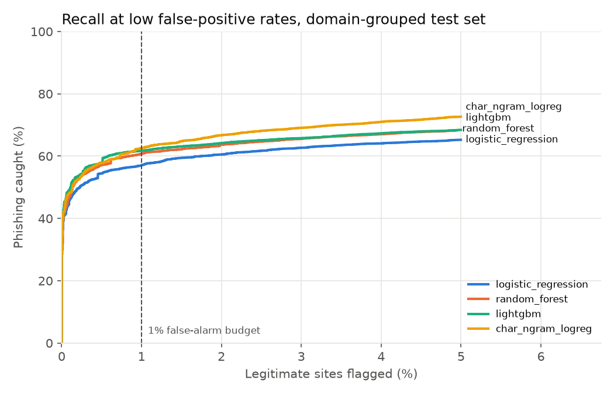
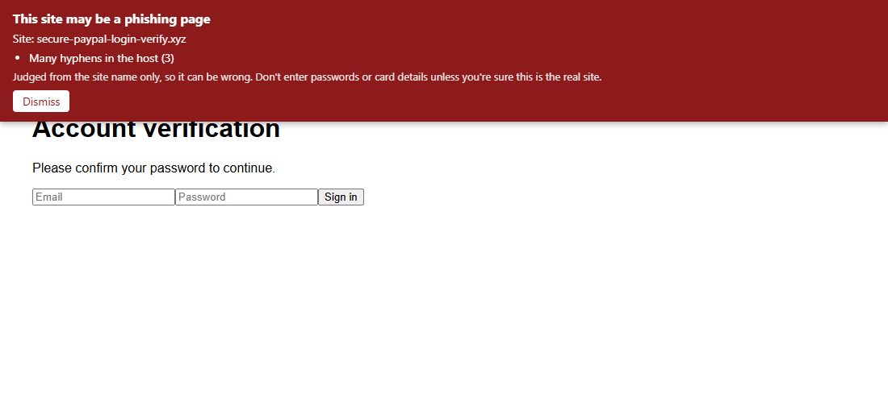

# Phishing URL detector

> Work in progress. Started October 2026.

Flags phishing links from the URL text alone, without opening the page. Trained on the [PhiUSIIL Phishing URL dataset](https://archive.ics.uci.edu/dataset/967/phiusiil+phishing+url+dataset) (UCI, about 235k URLs, 57% legitimate and 43% phishing), served through a small API, and used by a Chrome extension that warns before you land on a risky page.

URL-only matters for two reasons: it's fast enough to run before a page loads, and it never fetches anything from an attacker's server. The cost is less information to work with, and the project measures how much accuracy that costs.

## Early finding: the dataset has a shortcut

Every legitimate URL in PhiUSIIL is a bare homepage like `https://www.example.org`, and none of them have a path or sit on free hosting. A one-line regex ("is it a bare `https://www.` homepage?") gets **99.56% accuracy** with no machine learning at all. Models trained on raw URLs would learn that formatting difference instead of phishing, so this project trains on the **hostname only** and reports results there. Details in [notebooks/01_eda.ipynb](notebooks/01_eda.ipynb).

## Results so far (hostname only, test domains never seen in training)

Threshold chosen on a validation slice for at most 1% false alarms, then applied unchanged to the test set (47k URLs).

| Model | Phishing caught | Missed | False-alarm rate | PR-AUC | Fit time |
|-------|-----------------|--------|------------------|--------|----------|
| Logistic regression (11 features + TLD) | 57.9% | 7,583 | 1.15% | 0.874 | 4 s |
| Random forest (same features) | 60.3% | 7,148 | 0.92% | 0.880 | 61 s |
| LightGBM (same features) | 61.7% | 6,889 | 1.00% | 0.885 | 8 s |
| Character 2–5 grams of the hostname + logistic regression | **62.5%** | **6,749** | 0.99% | **0.908** | 9 s |



- At the 1% budget the four models are within 5 points of each other. The hand-made features have run out of signal more than the models have run out of capacity.
- The character model needs no feature code at all and is the best at every false-alarm rate above about 0.7%. Its ROC-AUC is 0.910 against 0.874–0.884 for the rest, so it ranks the "hard middle" better.
- LightGBM matches the random forest's recall at an eighth of the training time.
- A random row split instead of the domain split would have reported 61.9% and 65.9% for the first two: 4–6 points too optimistic, because the model gets to see other pages of the same domains in training.

These are still unflattering numbers. With the hostname alone, roughly 40% of phishing hosts look ordinary (`maria.susypro.com`). Day 6 attacks the models on purpose (homoglyphs, shorteners, padded subdomains) to see where each one breaks.

## Attacking it: where the models break

I took the test-set phishing each model already catches (10,410 to 11,244 URLs) and applied tricks an attacker fully controls. The table shows how many then slip under the 1% false-alarm threshold. Code: [attacks.py](src/phishing/attacks.py), [robustness.py](src/phishing/robustness.py).

| Attack | Example | Char n-grams | LightGBM | Logistic reg. | Random forest |
|--------|---------|--------------|----------|---------------|---------------|
| Move to a `.com` | `evil.xyz` → `evil.com` | 16.2% | 13.8% | 22.8% | 13.2% |
| Drop hyphens and digits | `secure-login-1.xyz` → `securelogin.xyz` | 7.2% | 4.9% | 6.8% | 6.2% |
| Cyrillic lookalike letters, before fix | `pаypаl.com` (Cyrillic а) | 15.8% | 0.9% | 4.4% | 3.1% |
| Cyrillic lookalike letters, after fix | same | 0% | 0% | 0% | 0.3% |
| Brand name as subdomain | `accounts.google.com.evil.xyz` | 0% | 0% | 0% | 0% |
| Long path and query | `evil.xyz/account/account/...` | 0% | 0% | 0% | 0% |

- **The fix:** lookalike hosts typed in Unicode were kept as Unicode, so the "punycode" feature never fired and the character model saw letters it had never met. Browsers and DNS use the `xn--` form, so the hostname is now converted to it first. Same domain, same features.
- **The open weakness:** buying a `.com` instead of a cheap TLD gets 13–23% of caught phishing through. The models lean on the TLD more than they should. Fixing that needs data where legitimate and phishing sites share TLDs, not a code change.
- **Long paths can't help** an attacker, by design: the features only look at the hostname.

Two "0%" results that are not strengths:

- **URL shorteners:** every `bit.ly` and `tinyurl.com` link in the dataset is phishing (289 of 289), so the models flag the shortener itself. A real extension would flag every legitimate short link too. The honest fix is to follow the redirect first, which a URL-only model can't do.
- **Free hosting** (`*.web.app`, `*.github.io`): the dataset has no legitimate sites there, so the models flag all of them, including real GitHub Pages sites.

## Scoring API

```bash
docker build -t phishing-api .        # downloads the dataset, trains, ships only the model
docker run -p 8000:8000 phishing-api

curl -X POST localhost:8000/score -H 'content-type: application/json'   -d '{"url": "http://192.168.4.20/bank"}'
# {"host":"192.168.4.20","label":"phishing","score":0.9974,"threshold":0.7879,
#  "reasons":["The address is a raw IP, not a domain name","Lots of digits in the host"]}
```

Without Docker: `uv run python -m phishing.export` then `uv run uvicorn phishing.api:app_from_env --factory`.

- Serves the character n-gram model (62.5% recall at 0.99% false alarms on unseen domains).
- URL shorteners answer `"unknown"` instead of a guess, because the real destination is hidden.
- The model file's SHA-256 is checked **before** it's loaded (joblib files are pickles, and loading a pickle runs code). Set `PHISHING_MODEL_SHA256` to pin the exact model; a mismatch stops the server from starting.
- The URLs people visit are never logged. Error messages don't echo the input. `/health` reports only counts per label.
- Only `http`/`https` URLs up to 2,048 characters, bodies up to 4 KB, unknown fields rejected, 60 requests per minute per client, CORS limited to `PHISHING_CORS_ORIGINS`.
- The image is built and tested on every push by [a GitHub Actions workflow](.github/workflows/docker.yml), runs as a non-root user and holds no dataset.

### A false alarm on github.com

The first live test scored `https://github.com/login` as phishing (0.87). The dataset explains it: all 408 github.com and github.io URLs in it are phishing (abused Pages sites and repos) and none are legitimate, so the model learned "github" as a warning sign. `google.com` has the same problem (10 rows, all phishing).

The API now passes a short list of well-known domains without scoring them. The check uses the registered domain, so `google.com.evil.xyz` (registered domain `evil.xyz`) and `someone.github.io` (each Pages site is its own domain) are still scored. Sixteen hand-picked domains is a stopgap; a real deployment would load a top-sites list like Tranco and refresh it.

## Chrome extension



The extension in [`extension/`](extension/) asks the scoring API about each site you open and shows a banner if the label is `phishing`. It warns and never blocks. A red "!" on the toolbar icon shows the same warning, and the page can't remove that one.

```bash
docker run -p 8000:8000 phishing-api          # the API from above, on localhost:8000
cd extension
corepack enable && pnpm install && pnpm build
# chrome://extensions → Developer mode → Load unpacked → extension/dist
```

What leaves the browser:
- Only `scheme://host/`. The model reads nothing else, so `https://site.example/reset?token=abc` is sent as `https://site.example/`.
- Nothing at all for `localhost`, private network addresses (`192.168.x.x`, `10.x.x.x`, …), dotless intranet names, or non-web pages (`chrome://`, `file://`).
- Verdicts are cached per host for 10 minutes in session storage, which lives in memory and is cleared when Chrome closes.

How it's locked down:
- Permissions are `storage` plus host access to the API. A test fails if the manifest asks for more.
- The page URL comes from Chrome (the message sender), not from the page, so a page can't make the extension score some other site.
- The banner sits in a closed shadow root and builds its text with `textContent`. A test feeds it `` and `<script>` reasons, and a lint rule bans `innerHTML`.
- The API call sends no cookies, follows no redirects, times out after 5 seconds and caps the response at 16 KB. A 429 pauses checks for the `Retry-After` time (at most 10 minutes).

112 tests cover these checks: bad responses, skipped addresses, cache expiry and tampering, the banner, and the manifest. I also broke the private-address check, the top-frame check and the text-only rendering one at a time, and each break failed its test. Checked end to end in Chromium against the real API: the phishing-looking host got the banner, `wikipedia.org` and `example.com` didn't, and `192.168.1.1` was never sent.

Limitations:
- The API address is fixed at `http://localhost:8000` in `src/config.ts` and the manifest. Pointing it elsewhere means changing both and rebuilding.
- Chrome warns at install that the extension can "read and change data on all websites". The content script has to run on every page to show a banner, even though it reads nothing.
- A phishing page can delete the banner element. The toolbar badge is the fallback.
- If the API is down there's no banner, only a grey "?" badge. The extension fails open: the alternative would be blocking browsing whenever the API is off.
- On pages the extension doesn't run on (`chrome://`, new tab), the badge from the previous page can stay until the next check.

## Plan

- [x] EDA: URL length, TLDs, subdomains, HTTPS, class balance
- [x] URL-only feature extractor with tests
- [x] Baselines (logistic regression, random forest), judged mostly on missed phishing
- [x] LightGBM and a character-level model on the hostname text
- [x] Robustness: homoglyphs, URL shorteners, long paths. Where does it break?
- [x] FastAPI `/score` endpoint + Docker
- [x] Chrome extension (TypeScript, Manifest V3)
- [ ] CI with security scans

## Stack

Python 3.12, pandas, scikit-learn, LightGBM, FastAPI, pytest, ruff, uv. Extension: TypeScript, Manifest V3, esbuild, Vitest, ESLint.

## Architecture

See [docs/ARCHITECTURE.md](docs/ARCHITECTURE.md). It includes a threat model focused on how attackers would try to get past the detector.

## License

MIT
