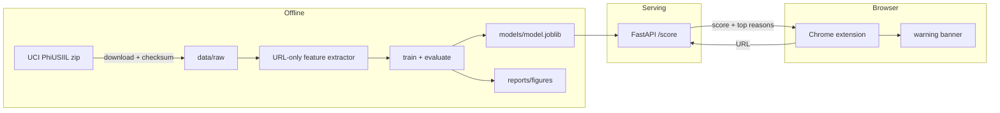

# Architecture

## Context

Three parts: an offline training pipeline, a scoring API, and a Chrome extension. The extension sends the URL of the page being opened to the API and shows a warning banner if the score is high.

## Components

| Component | Where | What it does |
|-----------|-------|--------------|
| Download | `src/phishing/data.py` | Fetches the UCI zip, checks the SHA-256, keeps only the `URL` and `label` columns |
| Feature extractor | `src/phishing/features.py` | Turns a URL string into numbers: length, digit ratio, subdomain count, TLD, IP-as-host, `@` and `//` tricks, punycode, entropy. Pure function, no network |
| Training | `src/phishing/train.py` | Split, baselines, LightGBM, char n-gram model; saves the chosen model |
| Evaluation | `src/phishing/metrics.py` | Recall on phishing, false-positive rate on legit sites, PR-AUC; robustness test sets |
| API | `src/phishing/api.py` | `POST /score {url}` → `{score, label, reasons}`. Stateless, runs in Docker |
| Extension | `extension/` | TypeScript, Manifest V3. Checks top-level navigations, shows a banner, never blocks the page |

## Decisions

- **URL-only features.** The dataset also has page-content features (title, forms, scripts), and they make the task much easier. But using them means fetching the attacker's page, which is slow and unsafe in a browser extension. I'll train a page-feature model once as a comparison to show what's lost.
- **Hostname only, not the full URL (added Day 2).** In PhiUSIIL every legitimate URL is a bare `https://www.<domain>` homepage, while phishing URLs have paths, `http`, no `www.`, and so on. A one-line regex on that format scores 99.56% accuracy with no ML. A model on full URLs would learn the collection method, not phishing. Path features wait until there are legit URLs with real paths from another source.
- **The main metric is recall on phishing at a fixed false-positive rate.** A missed phishing link is the expensive mistake. Too many false alarms train people to ignore the banner, so the false-positive rate gets a hard ceiling (for example 1%) and recall is maximised under it.
- **Split by domain, not by row.** The same domain can appear many times. A random row split lets the model memorise domains and look better than it is.
- **Feature extractor is a pure function with unit tests.** The same code runs in training and in the API, so they can't drift apart.
- **The extension warns, it doesn't block.** A model will be wrong sometimes. Blocking a legitimate site is worse for trust than a dismissible banner.

## Threat model

The detector is a security control, so the main threat is attackers **adapting their URLs to get past it**. The STRIDE table also covers the service itself.

### Evasion (the main risk)

| Attack | Example | Expected effect | Plan |
|--------|---------|-----------------|------|
| Homoglyphs / punycode | `pаypal.com` with a Cyrillic "а" → `xn--pypal-4ve.com` | Looks normal to a person, and length features barely change | Feature for punycode / mixed scripts. Day 6 test set |
| URL shorteners | `bit.ly/3xYz` | The real target is hidden, so a URL-only model sees very little | Treat known shorteners as "unknown" and say so in the UI, instead of guessing |
| Legit hosting | `sites.google.com/...`, `*.github.io`, `*.web.app` | Trusted domain, phishing path | Don't trust the domain alone. Path features matter. Measure recall on this group separately |
| Mimicking legit stats | Short URL, HTTPS, no digits, common TLD | Beats a model that only learned "phishing URLs are long and ugly" | This is the honest limit of URL-only detection. Report it |
| Data drift | New TLDs and new kits after the dataset was collected (published 2024) | Recall drops over time | Report the dataset date. Re-check on a fresh feed (PhishTank / OpenPhish) if time allows |

**Measured on Day 6** (full table in the README): Unicode homoglyphs got through up to 15.8% of the time until hostnames were converted to punycode first, after which it was 0–0.3%. Shorteners and free hosting were never missed, but only because the dataset labels every such URL phishing, so legitimate ones would be false alarms. Not predicted here: moving to a `.com` gets 13–23% through, the largest gap found.

### STRIDE for the API and extension

| STRIDE | Threat | Mitigation |
|--------|--------|------------|
| Spoofing | Another site or extension calls the API | CORS limited to the extension origin. It's a demo service with no user data, so no auth for now |
| Tampering | A tampered or malicious model file is loaded (`joblib` is pickle, and pickle runs code on load) | Only load the model built by this repo's pipeline. Check its hash at startup |
| Repudiation | n/a | No accounts and no actions to deny |
| Information disclosure | The browsing history of the user is sent to the API | Only top-level navigations are sent, never page content. Nothing is logged except counts. The README says this plainly. Running the API locally is the default |
| Denial of service | Huge or many requests | Max URL length 2,048, request body limit, rate limit per client |
| Elevation of privilege | The extension asks for more access than it needs | Minimal Manifest V3 permissions (`webNavigation`, `storage`, the API host). No `<all_urls>` content-script access beyond the banner |
